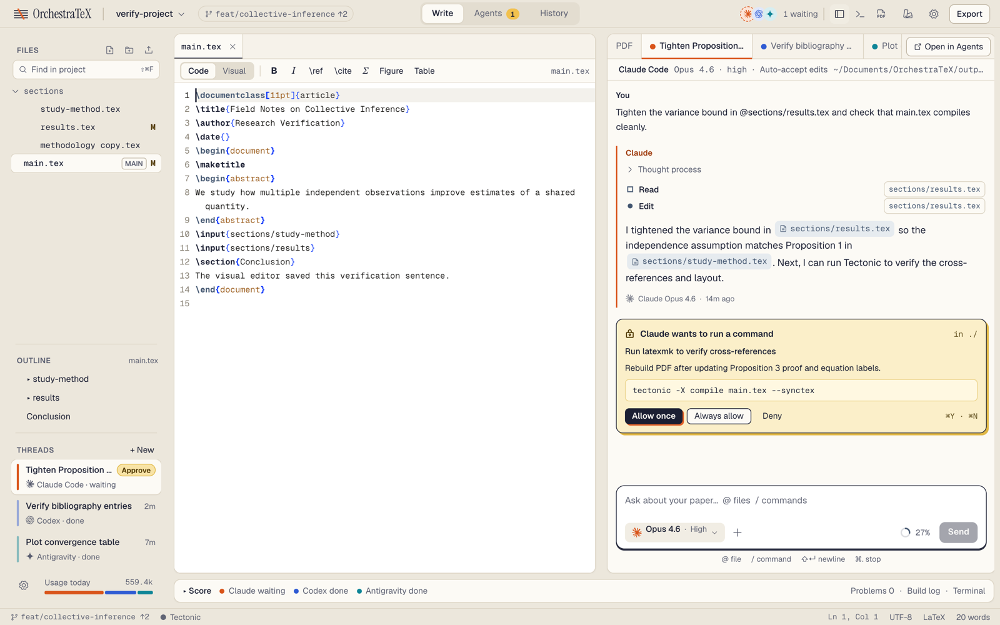
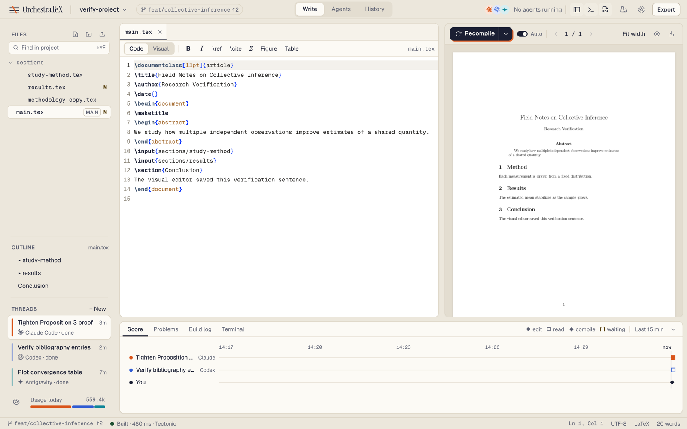
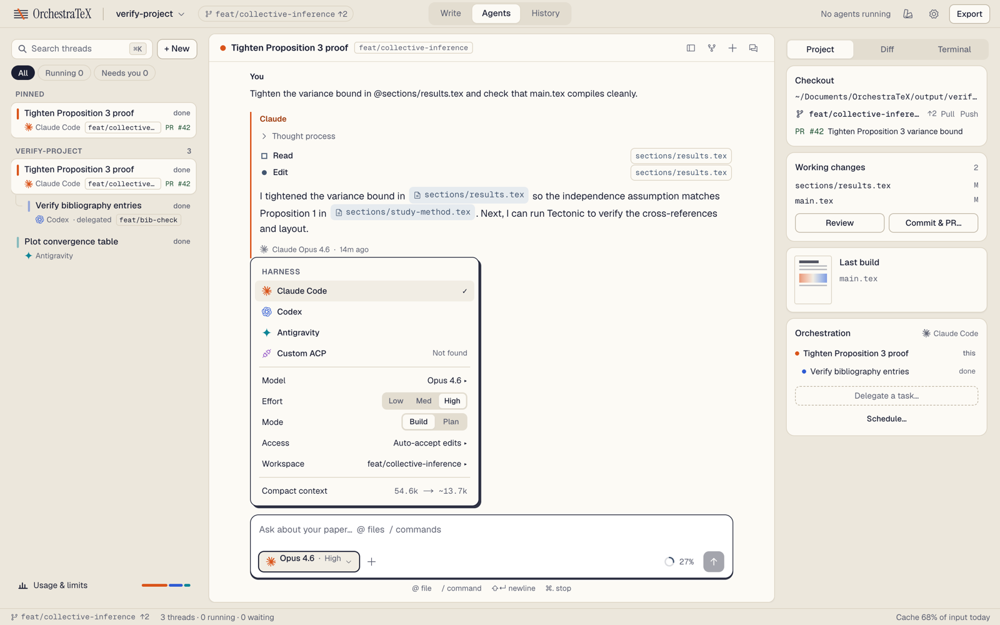
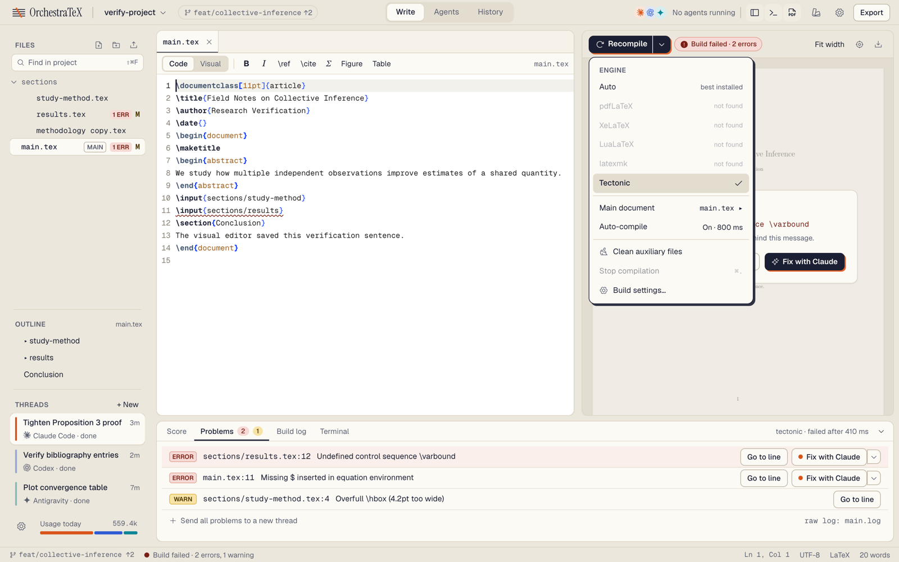
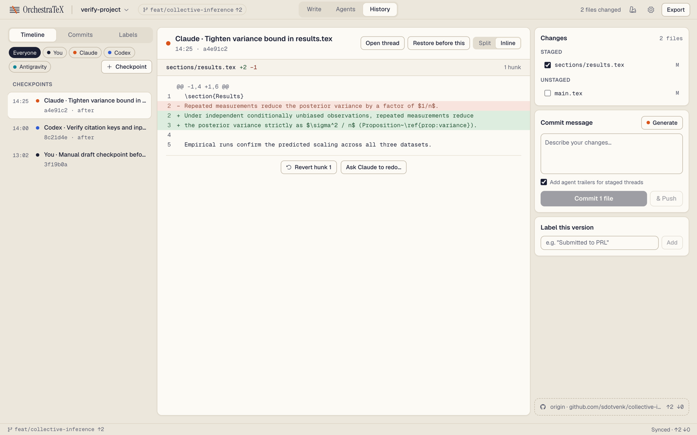
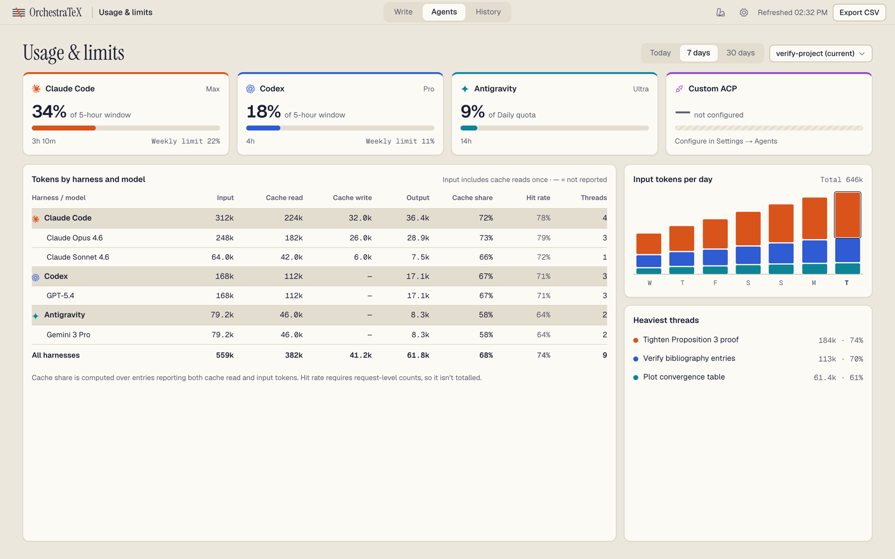
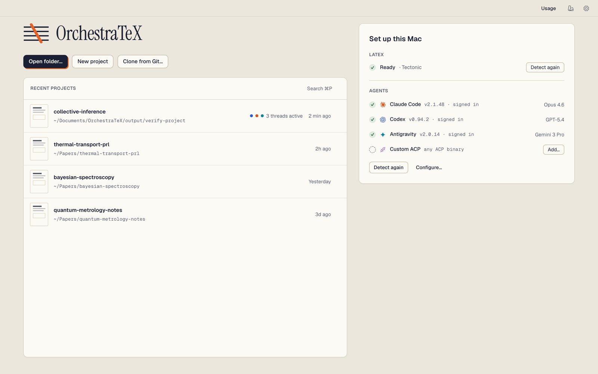
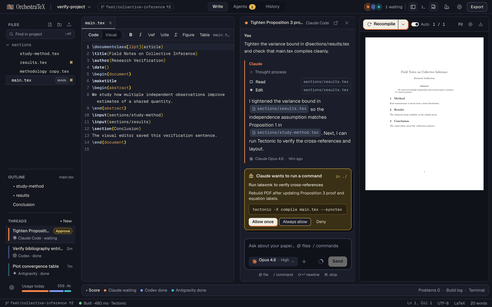

<div align="center">

# OrchestraTeX

**Local-first LaTeX editor with Overleaf-style live preview and a multi-agent workspace**

[](LICENSE)
[](#release-builds)
[](#release-builds)
[](#release-builds)
[](https://tauri.app/)
[](https://nodejs.org/)
[](https://www.rust-lang.org/)

[Developer Guide](docs/dev.md) · [Design C](docs/design-c/README.md) · [Based on LMMs-Lab Writer](archive/lmms-lab-writer/README_ORIGINAL.md)

</div>

<div align="center">

</div>

---

Claude Code, OpenAI Codex, Antigravity and any ACP agent work on your paper like Overleaf collaborators. Their edits show up in the source with Keep and Undo, the PDF rebuilds as they work, and every turn lands in Git history. Everything runs on your machine through the CLIs you're already signed in to.

## Write with agents in the document

Agent edits are attributed in the gutter and can be kept or undone one at a time. The PDF shows when it's behind, and SyncTeX jumps in both directions. The Score drawer plots what each thread read, edited, compiled and waited on.

<div align="center">

</div>

## Orchestrate threads across harnesses

Threads are grouped by project, with filters for running and waiting work. One Model · Effort chip opens the harness, model, effort, Build/Plan mode, access and workspace settings. Threads can delegate to other harnesses as child threads, and the inspector shows checkout, working changes, the last build and the delegation tree.

<div align="center">

</div>

## Build, diagnose, fix

Recompile and the engine menu live on the preview: latexmk, pdfLaTeX, XeLaTeX, LuaLaTeX and Tectonic. Problems link to the line and can be handed to an agent. Renaming a file offers to update its `\input` references.

<div align="center">

</div>

## History you can restore

Every agent turn is a checkpoint you can diff, restore or revert hunk by hunk. Stage and commit with an AI-written message and agent trailers, label versions, and push.

<div align="center">

</div>

## Usage across harnesses

Limit windows, tokens by harness and model, cache share and the heaviest threads. Quotas a provider doesn't report are shown as unknown, not zero.

<div align="center">

</div>

## Set up in one place

Home lists recent projects with their thread state, detects or installs a LaTeX distribution (TinyTeX, Tectonic, BasicTeX, MacTeX, MiKTeX, TeX Live) and checks each agent CLI.

<div align="center">

</div>

## Lux and Nocturne

<div align="center">
<table>
<tr>
<td align="center"><strong>Lux</strong></td>
<td align="center"><strong>Nocturne</strong></td>
</tr>
<tr>
<td></td>
<td></td>
</tr>
</table>
</div>

Auto follows the system appearance. Wide windows can show source, thread and PDF side by side.

---

## Agent runtime

The Rust backend (`apps/desktop/src-tauri/src/commands/agent/`) talks to locally installed, signed-in CLIs over stdin/stdout, so your own subscriptions and limits apply.

1. **Claude Code (`claude.rs`)**: `claude -p --input-format stream-json --output-format stream-json …`. Live model and permission changes, streaming, slash commands, question, plan and tool approval cards, cost and context tracking, rate-limit windows, forking and `/compact`.
2. **OpenAI Codex (`codex.rs`)**: a persistent `codex app-server --stdio` JSON-RPC 2.0 process. Model list, reasoning effort, thread start/resume/fork/compact, turn steer and interrupt, input and approval cards, token usage and rate-limit windows.
3. **Antigravity and Custom ACP (`acp.rs`)**: `agy acp --stdio`, or any ACP stdio server set in **Settings → Agents**. Sessions, modes, models, streaming updates, permission requests, usage, and project-scoped `fs/*` and `terminal/*` handlers.

## Quick start

```bash
git clone https://github.com/sdotvenk/OrchestraTeX.git
cd OrchestraTeX
pnpm install
pnpm tauri:dev
```

1. Sign in to the CLIs you use, or use **Sign in in Terminal** in the agent panel:
   - Claude Code: `claude auth login`
   - OpenAI Codex: `codex login`
   - Antigravity: `agy acp --login`
2. Install a TeX engine from Home if none is detected. Tectonic is the smallest and fetches packages on demand.
3. Open a LaTeX folder. `Cmd/Ctrl+Enter` compiles, `Cmd/Ctrl+P` toggles the PDF, and `Cmd/Ctrl+L` opens the agent panel.

## Release builds

Tauri builds for the platform it runs on, so build each OS on that OS (or let CI do it, below).

**All platforms:** Node.js 24+, pnpm, and stable Rust (`rustup`).

```bash
pnpm install --frozen-lockfile
pnpm version:set 0.2.0          # optional: sets the version in package.json, Cargo.toml and tauri.conf.json
pnpm tauri:build
```

Bundles land in `apps/desktop/src-tauri/target/release/bundle/` (or `target/<triple>/release/bundle/` with `--target`).

| Platform | Extra requirements | Command | Output |
| --- | --- | --- | --- |
| macOS, Apple Silicon | Xcode Command Line Tools | `pnpm tauri:build` | `bundle/macos/OrchestraTeX.app`, `bundle/dmg/*.dmg` |
| macOS, Intel | `rustup target add x86_64-apple-darwin` | `pnpm --filter @orchestratex/desktop tauri build --target x86_64-apple-darwin` | same, under `target/x86_64-apple-darwin/` |
| macOS, universal | both Apple targets | `pnpm --filter @orchestratex/desktop tauri build --target universal-apple-darwin` | same, under `target/universal-apple-darwin/` |
| macOS `.pkg` | after a macOS build | `./scripts/build-pkg.sh` | `bundle/pkg/*.pkg` |
| Windows | Visual Studio Build Tools (C++ workload), WebView2 | `pnpm tauri:build`, or `./scripts/build-windows.ps1 -Arch x64` | `bundle/nsis/*-setup.exe`, `bundle/msi/*.msi` |
| Linux | `libwebkit2gtk-4.1-dev libappindicator3-dev librsvg2-dev patchelf` | `pnpm tauri:build` | `bundle/appimage/*.AppImage`, `bundle/deb/*.deb`, `bundle/rpm/*.rpm` |

**Signing.** Builds are unsigned unless you configure it. On macOS, set `APPLE_SIGNING_IDENTITY` (and `APPLE_ID`, `APPLE_PASSWORD`, `APPLE_TEAM_ID` for notarization) before building; otherwise users need to right-click → Open the first time. On Windows, configure `bundle.windows.certificateThumbprint` or users will see a SmartScreen prompt.

**CI.** Pushing a `v*` tag runs `.github/workflows/build.yml`, which syncs the version from the tag, builds Linux, macOS (ARM64 and x64) and Windows, and uploads the bundles as workflow artifacts. Download them and attach them to a release:

```bash
git tag v0.2.0 && git push origin v0.2.0
# when the Release workflow finishes:
gh run download --dir release-artifacts      # pick the Release run
find release-artifacts -type f \( -name '*.dmg' -o -name '*.pkg' -o -name '*-setup.exe' \
  -o -name '*.msi' -o -name '*.AppImage' -o -name '*.deb' -o -name '*.rpm' \) -print0 \
  | xargs -0 gh release create v0.2.0 --title "OrchestraTeX v0.2.0" --generate-notes
```

For a local macOS build, `./scripts/upload-to-github-release.sh --create` uploads the DMG and PKG from `target/release/bundle/`.

See **[docs/dev.md](docs/dev.md)** for architecture, the Rust IPC command reference and verification commands.

## License

MIT. See [LICENSE](LICENSE). OrchestraTeX is derived from [LMMs-Lab Writer](https://github.com/EvolvingLMMs-Lab/lmms-lab-writer) by LMMs-Lab; their original README is preserved in [archive/lmms-lab-writer/](archive/lmms-lab-writer/README_ORIGINAL.md).
